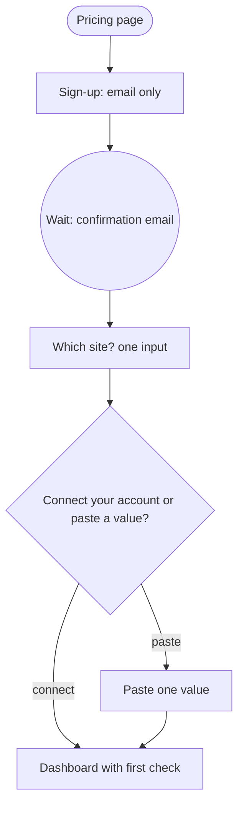

# Flow maps

Map the flow before anything is built: a plain flow chart from entry to the
value moment, with every screen, question and wait on the way. No mockups.
Then shorten it from the value moment backwards: for each step before value,
can the product decide it, defer it until after value, merge it into the next
screen, or move it aside? Redraw and measure again. Build only the map that
wins.

## Where maps live

`.flowchad/flows/<id>.map.md`, next to the flow's YAML when it exists, with
the same id. Commit it. A map can exist alone (nothing built yet); once the
flow is walkable, the YAML's steps follow the map and `/flow-diagram` can
redraw the map from the walk.

```markdown
# New user sets up their first site and sees its first check

- **Value moment:** The dashboard shows the first check of the person's own site.
- **Visitor:** a new user arriving from the pricing page


```

## Conventions

| Shape | Mermaid | Counts as |
|---|---|---|
| Entry or exit | `id([Label])` | terminal (not a screen) |
| Screen | `id[Label]` (also `[[ ]]`, `[/ /]`, `( )`) | one screen |
| Question the person answers | `id{Label}` | one decision |
| Wait the person cannot skip | `id((Label))` | one wait |
| Value moment | `:::value` after the node, or `class id value` | the target |

Edges: `-->`, with optional labels `-->|label|` or `-- label -->`. `A & B -->
C` is two edges. Put every branch the person can take, including the error
branches; a screen with no way out is a dead end.

## Judging a map

```
/flow-walk <id> --map
```

1. `node scripts/flowmap.mjs .flowchad/flows/<id>.map.md --out
   .flowchad/snapshots/<date>-<id>-map/results.json` measures the shortest
   path from entry to value: screens, decisions and waits on it, dead ends,
   loops (edges that send the path back to an earlier step of the path) and
   unreachable nodes.
2. Judge every rule whose `Applies to` includes `map` (see `../rules/`):
   PATH-01 to PATH-06, DEC-01 to DEC-03, NAV-04 and ERR-01. Record each in the
   result's `rule_results` as pass, fail or n/a with what was seen.
3. Run the gate (`/flow-gate`) on that result. A map passes when the value
   moment is declared and reachable, it has no dead ends, and no blocker
   rule fails. Compare the numbers with the previous map or the current
   product's walk: the redrawn map should have fewer screens, decisions and
   waits, or a stated reason why not.

A map is a claim about a design, not evidence that it works. The gate for a
hand-off still needs a walk of the built flow.
